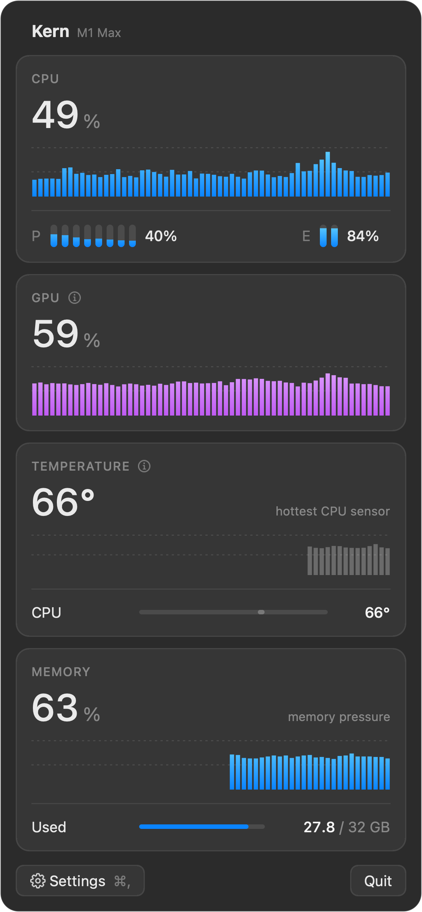
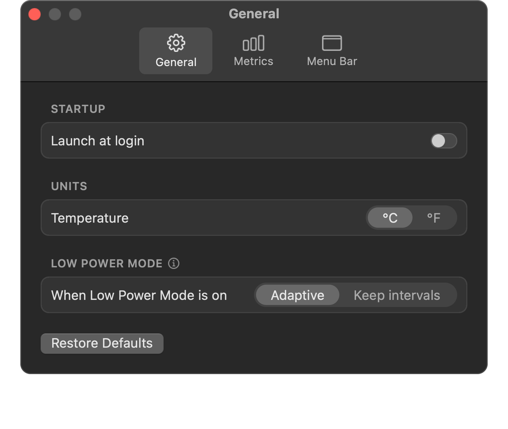
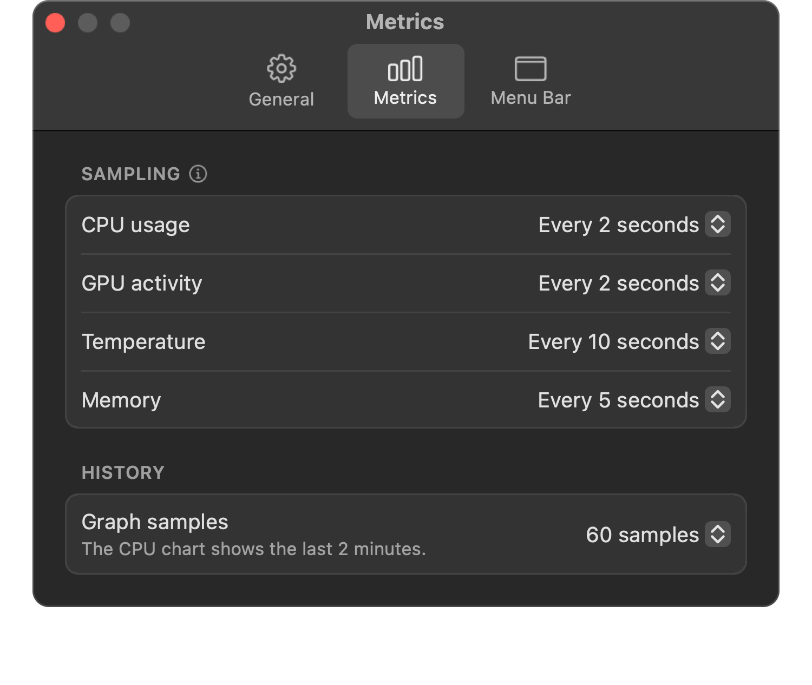
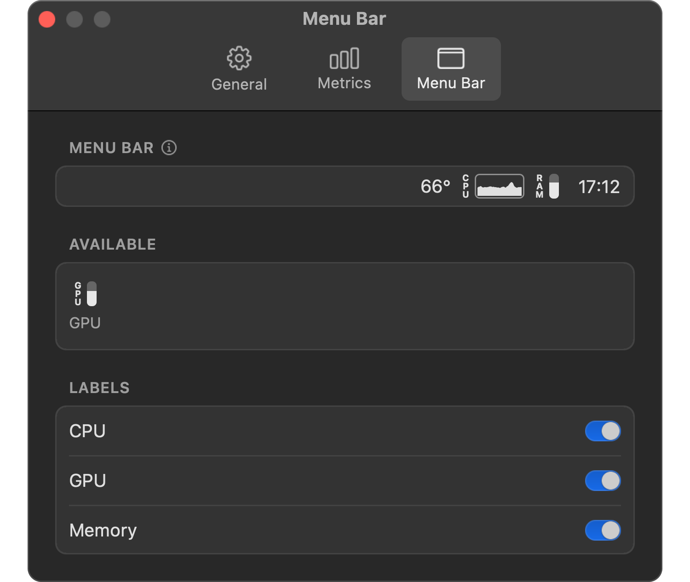

<p align="center">
  
</p>

# Kern

Kern is pronounced [kɛʁn], like the German word for "core".

A lightweight macOS menu-bar monitor for Apple Silicon. Kern shows CPU temperature, a CPU usage graph, GPU activity, and memory pressure in the menu bar, and is built to use almost no resources itself.

<p align="center">
  
</p>

<p align="center">
  
</p>

## Requirements

- A Mac with an M1, M2, M3, M4, or M5 chip
- macOS 15 or later
- Xcode 16.3 or later

## Getting started

```sh
# build
swift build -c release --arch arm64

# run the tests
swift test

# show what Kern reads on this Mac
swift run kern-probe
```

The app runs as a menu-bar item with no Dock icon and no window:

```sh
xcodebuild -project App/Kern.xcodeproj -scheme Kern -configuration Release -derivedDataPath .build/xcode build
open .build/xcode/Build/Products/Release/Kern.app
```

Or open `App/Kern.xcodeproj` in Xcode and run the `Kern` scheme.

Click the menu-bar item for the details of every metric.

By default the menu bar shows the CPU temperature, a chart of the last two minutes of CPU use, a gauge of GPU activity, and a gauge of memory pressure, in that order.

<p align="center">
  
  
  
</p>

Kern keeps its settings in the `dev.kern.Kern` defaults domain.

Kern stops sampling while the Mac sleeps and samples again as soon as it wakes. In Low Power Mode it samples CPU, GPU, and its own usage every 5 seconds, used memory and memory pressure every 10, and temperature every 20, unless an interval is set longer than that or Settings is set to keep the intervals.

A sensor that fails is tried again after one interval, then after two, four, and so on, until the wait would pass a minute. Its readings return at the first retry that works.

Debug builds accept `--fail <metric>[:<seconds>]` to make a sensor fail, `--chip "<brand string>"` to pretend to run on another chip, and `--settings-after <seconds>` to open Settings by itself that long after launch.

`kern-probe` is a development tool that prints sensor readings in the terminal. It is not part of the app.

```sh
$ swift run kern-probe
chip: M1 Max

$ swift run -c release kern-probe cpu # one CPU reading every 2 seconds until Ctrl-C
chip: M1 Max
21:47:45  cpu.host_processor_info  utilization  unavailable (awaiting baseline)
21:47:47  cpu.host_processor_info  utilization   53.6 %  (user  25.8 %, system  27.8 %)
21:47:49  cpu.host_processor_info  utilization   49.6 %  (user  18.0 %, system  31.6 %)

$ swift run -c release kern-probe gpu # one GPU reading every 2 seconds until Ctrl-C
chip: M1 Max
14:30:56  gpu.ioreport.gpuph  active residency  unavailable (awaiting baseline)
14:30:58  gpu.ioreport.gpuph  active residency   59.4 %
14:31:00  gpu.ioreport.gpuph  active residency   51.9 %

$ swift run -c release kern-probe temperature # one CPU temperature every 10 seconds until Ctrl-C
chip: M1 Max
21:48:10  temperature.smc.cpu  temperature   67.1 °C  (cpu 63.7 to 67.1 °C)
21:48:20  temperature.smc.cpu  temperature   70.7 °C  (cpu 66.7 to 70.7 °C)

$ swift run -c release kern-probe memory # the share of memory in use every 5 seconds until Ctrl-C
chip: M1 Max
21:48:50  memory.host_statistics64  memory in use   86.7 %  (27.76 of 32.00 GiB)
21:48:55  memory.host_statistics64  memory in use   87.0 %  (27.83 of 32.00 GiB)
$ swift run -c release kern-probe memory-pressure # the memory pressure every 5 seconds until Ctrl-C
chip: M1 Max
21:59:22  memory.memorystatus_level  memory pressure   70.0 %
21:59:27  memory.memorystatus_level  memory pressure   66.0 %

$ swift run -c release kern-probe kern # the probe's own CPU use and footprint every 2 seconds until Ctrl-C
chip: M1 Max
21:18:48  kern.getrusage_task_info  process usage  unavailable (awaiting baseline)
21:18:50  kern.getrusage_task_info  process usage    0.0 %  (footprint 2.5 MiB)
```

Memory pressure is the share of memory that macOS cannot give to an app without first reclaiming it, and the menu bar's RAM gauge shows it. Once memory is full, used memory stays near the top while pressure keeps moving with how hard macOS is working.

The first CPU and GPU readings are always unavailable, because both numbers are the change between two readings. The app and the `metrics` command read them again a quarter of a second later, so a value follows right away. The GPU number is active-state residency, not utilization. It is the share of time the GPU was powered on, which includes time spent drawing the screen, so an idle desktop does not read zero.

The temperature is the hottest of the CPU die sensors that have been verified for the chip. On a chip without a verified sensor map, which today means every chip except the M1 Max, it is always unavailable.

The `metrics` command runs all the metrics the way the app does, each on its own schedule, and prints what the app would read for a metric each time it is sampled:

```sh
$ swift run -c release kern-probe metrics # until Ctrl-C or Ctrl-D
chip: M1 Max
21:48:22  memory-pressure   70.0 %  history 1/60, 0 gaps
21:48:22  cpu              unavailable (awaiting baseline)  history 1/60, 1 gap
21:48:22  temperature       71.1 °C  (cpu 67.0 to 71.1 °C)  history 1/60, 0 gaps
21:48:22  gpu              unavailable (awaiting baseline)  history 1/60, 1 gap
21:48:22  cpu               40.6 %  (user  16.1 %, system  24.5 %)  history 2/60, 1 gap
21:48:22  gpu               48.3 %  history 2/60, 1 gap
21:48:24  cpu               49.6 %  (user  21.0 %, system  28.5 %)  history 3/60, 1 gap
21:48:24  gpu               49.6 %  history 3/60, 1 gap
disable gpu
21:48:25  gpu              history 0/60, 0 gaps
21:48:25  gpu disabled
21:48:26  cpu               46.1 %  (user  19.5 %, system  26.6 %)  history 4/60, 1 gap
21:48:27  memory-pressure   69.0 %  history 2/60, 0 gaps
21:48:28  cpu               53.5 %  (user  23.0 %, system  30.6 %)  history 5/60, 1 gap
interval cpu 1
21:48:30  cpu               53.5 %  (user  23.0 %, system  30.6 %)  history 5/60, 1 gap
21:48:30  cpu every 1 s
21:48:30  cpu               50.2 %  (user  25.5 %, system  24.7 %)  history 6/60, 1 gap
21:48:31  cpu               62.9 %  (user  24.0 %, system  38.9 %)  history 7/60, 1 gap
```

While it runs, type `enable <metric>`, `disable <metric>`, or `interval <metric> <seconds>` to change the schedules, where `<metric>` is `cpu`, `gpu`, `temperature`, `memory`, `memory-pressure`, or `kern`. Used memory is sampled only after `details on`, as the app samples it only while its popover is open, and `details off` stops it again. The probe's own usage is sampled only after `enable kern`, as the app samples its own only while the Kern usage widget is in the menu bar or Settings is open. `sleep` and `wake` suspend and resume sampling as the app does when the Mac sleeps and wakes. `low-power on` and `low-power off` sample as the app does while Low Power Mode is on or off, and `low-power-behavior override` or `low-power-behavior adaptive` sets whether Low Power Mode slows the sampling down. A sample without a value stays in the history as a gap. When the latest sample has no value, the line also shows the last successful value and whether it is still current or already stale.

To find the temperature sensors of a new chip, list every temperature the SMC reports, one comma-separated row per second, and watch which ones follow a CPU load:

```sh
swift run -c release kern-probe temperature-sensors > sensors.csv
```

`Scripts/process-cost.swift` prints what a running process has cost so far in CPU time and wakeups, the counters Activity Monitor uses:

```sh
swift Scripts/process-cost.swift <pid>
```

`Scripts/gpu-load.swift` puts a steady, full load on the GPU for a given number of seconds (60 by default), so GPU readings can be compared at idle and under load:

```sh
swift Scripts/gpu-load.swift 60
```

`Scripts/memory-load.swift` fills a given amount of memory (4 GiB by default) with random bytes that cannot be compressed, holds it for a given time (30 seconds by default), and frees it:

```sh
swift Scripts/memory-load.swift 4 30
```

`kern-popover-bench` measures how long the popover takes to open and how much memory it leaves behind. It runs Kern from a Release build and opens and closes the popover by posting clicks to its own menu-bar item:

```sh
$ swift build -c release --product kern-popover-bench && .build/release/kern-popover-bench 50
memory before the first opening: footprint 13.1 MiB, resident 24.1 MiB
memory after 1 opening: footprint 14.3 MiB, resident 31.5 MiB
memory after 20 openings: footprint 18.0 MiB, resident 40.0 MiB
memory after 50 openings: footprint 19.3 MiB, resident 41.5 MiB
openings: 50, 0 failed checks
click to drawn, ms: median 40.7, p95 50.9, max 61.0
```

`kern-power-bench` runs Kern and announces sleep and wake to it ten times, without putting the Mac to sleep. It puts an item in the menu bar while it runs, next to Kern's own if Kern is running. `Scripts/schedule-report.swift` reads Kern's debug log and prints what Kern did at each sleep and wake. It checks that nothing was sampled during a sleep, that every provider was stopped and started again, that every metric was sampled within 5 seconds of the wake without a burst, and that each metric still has exactly one schedule at the end:

```sh
$ swift build -c release --product kern-power-bench
$ log stream --style ndjson --level debug --predicate 'subsystem == "Kern" && process == "kern-power-bench"' \
  | swift Scripts/schedule-report.swift    # in a second terminal, until Ctrl-C
$ .build/release/kern-power-bench 10
```

The script reports real sleeps the same way. Start it with `process == "Kern"` in the predicate while the app runs, put the Mac to sleep and wake it as often as wanted, and press Ctrl-C. With more than one Kern running, add `&& processID == <pid>` to the predicate.

`kern-settings-bench` runs Kern, opens its details with a click and presses ⌘, in them, which must open Settings, and then makes 100 random settings changes. It prints Kern's memory before and after the changes, and the same report script checks that every metric has exactly one schedule after the last change, or none when it is turned off. It keeps its settings in its own defaults domain, so Kern's are not touched:

```sh
$ swift build -c release --product kern-settings-bench
$ log stream --style ndjson --level debug --predicate 'subsystem == "Kern" && process == "kern-settings-bench"' \
  | swift Scripts/schedule-report.swift    # in a second terminal, until Ctrl-C once the bench has ended
$ .build/release/kern-settings-bench 100
```

## Project layout

| Path                          | Contents                                                        |
| ----------------------------- | --------------------------------------------------------------- |
| `Sources/KernCore`            | Chip detection, sensors, and metric collection                  |
| `Sources/KernUI`              | The menu bar, the popover, Settings, and the app's startup      |
| `Sources/kern-probe`          | The development probe                                           |
| `Sources/kern-popover-bench`  | The popover measurement tool                                    |
| `Sources/kern-power-bench`    | The sleep and wake test tool                                    |
| `Sources/kern-settings-bench` | The settings change test tool                                   |
| `App`                         | The Xcode project with the app's entry point and build settings |
| `Tests/KernCoreTests`         | Unit tests of the core                                          |
| `Tests/KernUITests`           | Unit tests of the menu bar, the popover, and Settings           |
| `Scripts`                     | Development measurement scripts                                 |
